# MANUAL BOOK
# SISTEM APYRENT
## PT Rental Kendaraan Indonesia

---

# BAB 1: LOGIN DAN DASHBOARD

## A. LOGIN KE SISTEM

Cara masuk ke dashboard administrator APYRent:

1. **Buka Browser** (Mozilla Firefox / Google Chrome)

2. **Ketik url:** http://[alamat-server]/login
   
   Domain merupakan alamat website.
   
   Contoh: apyrent.com/login, rental.co.id/login, 127.0.0.1:8000/login, dll

3. **Akan tampil seperti berikut:**

   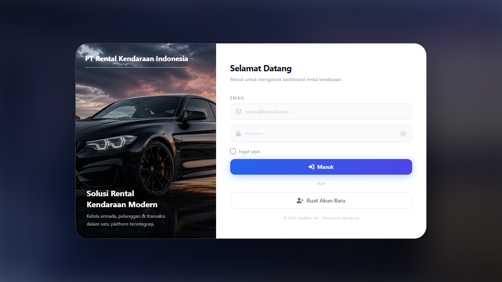
   
   *Gambar 1: Halaman Login

4. **Masukkan username dan password** yang telah diberikan oleh Admin, isi penjumlahan angka dibawah password, dan terakhir klik **Masuk**

   Contoh:
   - Email: `test@example.com`
   - Password: `••••••••`

5. **Jika username, password, dan penjumlahan benar** maka selamat Anda telah masuk ke halaman dashboard website.

   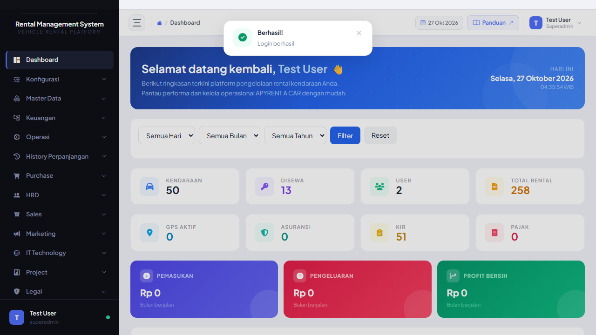
   
   *Gambar 2: Dashboard setelah login

---

## B. DASHBOARD UTAMA

Setelah login berhasil, Anda akan masuk ke halaman **Dashboard** - halaman utama yang menampilkan ringkasan data.

*Gambar 3: Dashboard Utama - Widget statistik, menu sidebar, dan grafik*

### Penjelasan Menu Dashboard:

Dashboard APYRent menampilkan informasi penting:

1. **Total Kendaraan** - Jumlah seluruh kendaraan dalam armada
2. **Kendaraan Aktif** - Kendaraan yang sedang dirental atau siap rental  
3. **Kendaraan Service** - Kendaraan yang sedang maintenance
4. **Rental Aktif** - Jumlah kontrak rental yang sedang berjalan
5. **Invoice Pending** - Invoice yang belum dibayar
6. **Total Pendapatan Bulan Ini** - Akumulasi pembayaran bulan berjalan
7. **Pajak Jatuh Tempo** - Kendaraan yang pajaknya akan expired dalam 30 hari
8. **Asuransi Jatuh Tempo** - Kendaraan yang asuransinya akan expired dalam 30 hari

### Menu Sidebar:

Menu di sisi kiri adalah navigasi utama untuk mengakses semua fitur:

- 🏠 **Dashboard** - Halaman ini
- 🚗 **Kendaraan** - Kelola data kendaraan
- 📝 **Rental** - Kelola kontrak rental
- 🔧 **Service** - Maintenance kendaraan
- 📋 **Compliance** - Pajak, Asuransi, GPS, KIR, STNK
- 💰 **Keuangan** - Invoice dan pembayaran
- 📊 **Laporan** - Export data
- 👥 **Master Data** - Pelanggan, Member, Supplier

---

## C. LOGOUT

Cara keluar dari sistem:

1. **Klik nama user** di pojok kanan atas header

   2. **Klik tombol "Logout"**

   3. **Anda akan diarahkan kembali ke halaman login**

**Catatan:** 
- Selalu logout setelah selesai menggunakan sistem
- Jangan tinggalkan komputer dalam keadaan login

---

# BAB 2: DATA & STOK KENDARAAN

## A. LIHAT DATA KENDARAAN

Cara melihat daftar semua kendaraan:

1. **Klik menu "Kendaraan"** di sidebar kiri

   2. **Klik submenu "Data Kendaraan"**

3. **Akan tampil tabel daftar kendaraan seperti berikut:**

   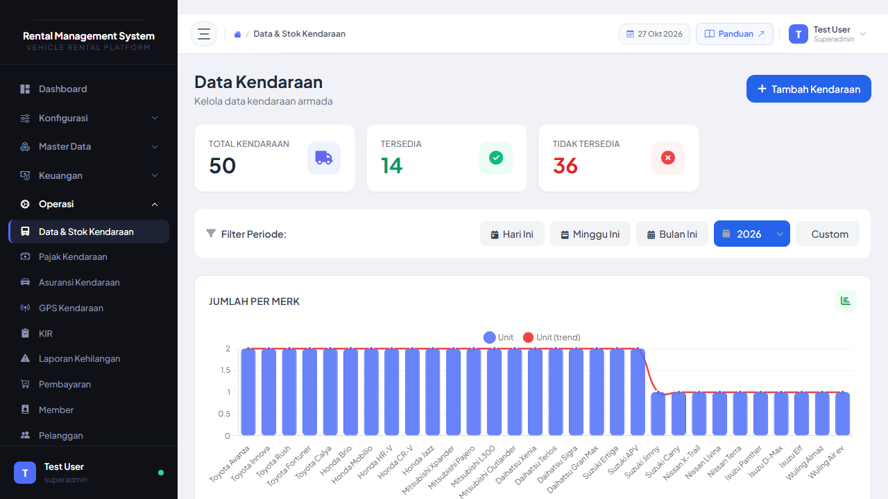
   
   ### Penjelasan Kolom Tabel:

- **Nomor Polisi** - Nomor plat kendaraan
- **Merk** - Merek kendaraan (Toyota, Honda, dll)
- **Type** - Tipe kendaraan (Avanza, Xenia, dll)
- **Jenis** - Kategori (Sedan, Minibus, Truck)
- **Tahun** - Tahun pembuatan
- **Warna** - Warna kendaraan
- **Status** - Status kendaraan (Aktif, Service, Idle, Rusak)
- **Aksi** - Tombol Edit dan Hapus

---

## B. TAMBAH KENDARAAN BARU

Cara menambahkan kendaraan baru ke sistem:

1. **Klik tombol "Tambah Kendaraan"** di pojok kanan atas tabel

2. **Akan muncul form seperti berikut:**

   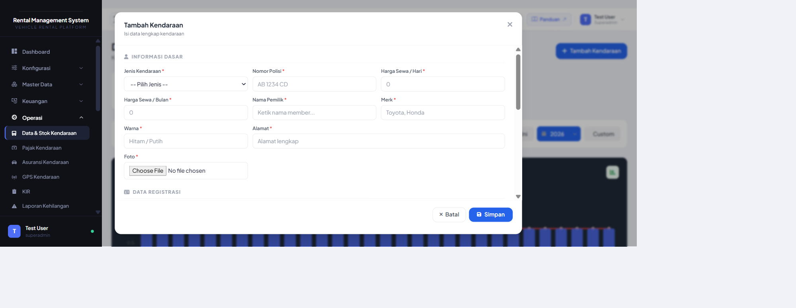3. **Isi form dengan data kendaraan:**

   **Data Wajib Diisi:**
   - **Nomor Polisi** - Contoh: B 1234 XYZ
   - **Merk** - Pilih dari dropdown (Toyota, Honda, Daihatsu, dll)
   - **Type** - Contoh: Avanza 1.3 G
   - **Jenis Kendaraan** - Pilih dari dropdown (Sedan, Minibus, Truck, dll)
   - **Tahun Pembuatan** - Contoh: 2020
   - **Warna** - Contoh: Hitam Metalik
   - **Status** - Pilih: Aktif / Service / Idle / Rusak

   **Data Opsional:**
   - **Nomor Rangka** - Nomor seri kendaraan
   - **Nomor Mesin** - Nomor mesin kendaraan
   - **Kilometer Awal** - Contoh: 50000
   - **Harga Beli** - Contoh: 250000000
   - **Foto Kendaraan** - Upload foto (format: JPG, PNG)
   - **Keterangan** - Catatan tambahan

4. **Upload Foto Kendaraan (Opsional)**

   a. Klik tombol "**Pilih File**" pada bagian Foto Kendaraan
   
   b. Pilih foto dari komputer Anda
   
   c. Foto akan muncul preview setelah dipilih

   5. **Klik tombol "Simpan"** setelah semua data diisi

   6. **Jika berhasil**, akan muncul notifikasi "Data kendaraan berhasil disimpan" dan kendaraan baru akan tampil di tabel---

## C. EDIT DATA KENDARAAN

Cara mengubah data kendaraan yang sudah ada:

1. **Cari kendaraan** yang ingin diubah di tabel

2. **Klik icon "Edit" (pensil)** pada kolom Aksi

3. **Akan muncul form edit** dengan data kendaraan yang sudah terisi

   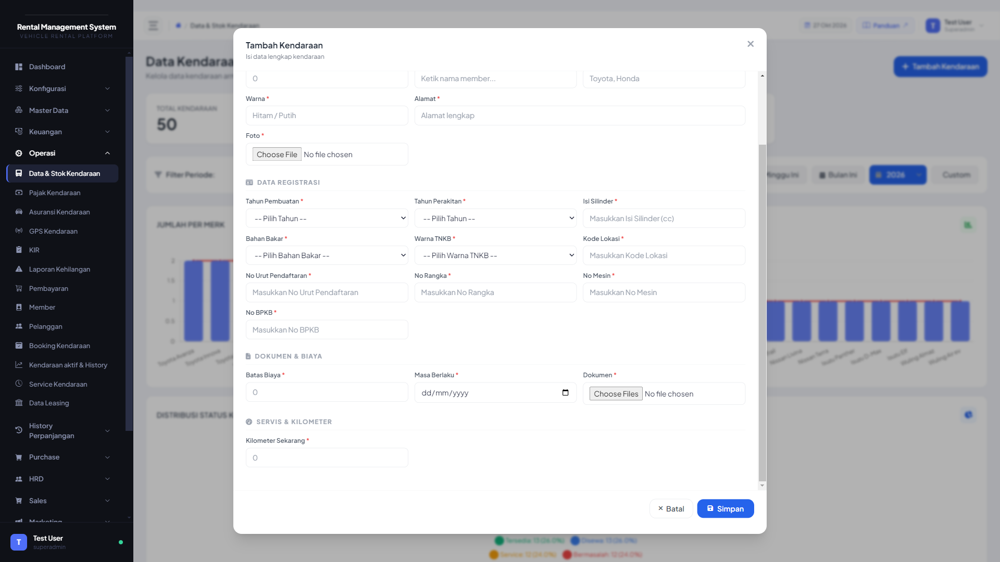4. **Ubah data** yang ingin diubah

   Contoh:
   - Ubah Status dari "Aktif" menjadi "Service"
   - Ubah Kilometer menjadi angka yang lebih baru
   - Ganti Foto Kendaraan

5. **Klik tombol "Update"** untuk menyimpan perubahan

   6. **Jika berhasil**, akan muncul notifikasi "Data kendaraan berhasil diupdate"

---

## D. HAPUS KENDARAAN

Cara menghapus data kendaraan:

1. **Cari kendaraan** yang ingin dihapus di tabel

2. **Klik icon "Hapus" (tempat sampah)** pada kolom Aksi

   3. **Akan muncul konfirmasi hapus** seperti berikut:Pesan: "Apakah Anda yakin ingin menghapus kendaraan [Nomor Polisi]?"

4. **Klik "Ya, Hapus!"** untuk menghapus, atau **"Batal"** untuk membatalkan

5. **Jika berhasil dihapus**, kendaraan akan hilang dari tabel dan muncul notifikasi "Data kendaraan berhasil dihapus"

**Catatan Penting:**
- Data yang sudah dihapus **tidak bisa dikembalikan**
- Pastikan kendaraan tidak memiliki rental aktif sebelum dihapus
- Hanya Superadmin yang bisa menghapus kendaraan

---

# BAB 3: PAJAK KENDARAAN

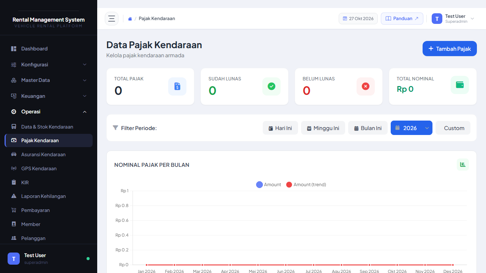

## A. LIHAT DAFTAR PAJAK

Cara melihat status pajak semua kendaraan:

1. **Klik menu "Compliance"** di sidebar

   2. **Klik submenu "Pajak Kendaraan"**

3. **Akan tampil tabel daftar pajak kendaraan:**### Penjelasan Status Badge:

- **Hijau (Aktif)** - Pajak masih berlaku > 30 hari
- **Kuning (Akan Expired)** - Pajak akan expired dalam 30 hari ke depan
- **Merah (Expired)** - Pajak sudah lewat masa berlaku

---

## B. PERPANJANG PAJAK

Cara memperpanjang pajak kendaraan yang akan expired:

1. **Cari kendaraan** yang pajaknya akan expired (badge kuning atau merah)

2. **Klik tombol "Perpanjang"** pada kolom Aksi

   3. **Akan muncul form perpanjang pajak:**4. **Isi form perpanjang pajak:**

   **Data Wajib:**
   - **Tanggal Bayar** - Tanggal pembayaran pajak (format: dd/mm/yyyy)
   - **Tanggal Expired Baru** - Tanggal berakhir pajak yang baru (biasanya 1 tahun dari bayar)
   - **Nominal Pajak** - Biaya pajak yang dibayarkan (angka saja, tanpa titik/koma)
   - **Bukti Bayar** - Upload foto bukti transfer/struk (JPG, PNG, PDF)

   **Data Opsional:**
   - **Keterangan** - Catatan tambahan
   - **Nomor STNK** - Jika ada perubahan

5. **Upload Bukti Bayar:**

   a. Klik tombol "**Pilih File**"
   
   b. Pilih file bukti transfer dari komputer
   
   c. File akan muncul nama filenya setelah dipilih

   6. **Klik tombol "Ajukan"**

   7. **Pengajuan akan masuk ke Purchase Order (PO)** untuk menunggu approval dari Superadmin8. **Status pajak** akan berubah menjadi "**Menunggu Approval**" dengan badge kuning

---

## C. AJUKAN ULANG (Jika Ditolak)

Jika pengajuan perpanjang pajak ditolak oleh Superadmin:

1. **Akan muncul notifikasi** bahwa pengajuan Anda ditolak

2. **Buka menu Pajak Kendaraan** lagi

3. **Cari kendaraan** yang pengajuannya ditolak (badge merah dengan label "Ditolak")

4. **Klik tombol "Ajukan Ulang"**

   5. **Akan muncul form ajukan ulang** dengan data sebelumnya yang masih terisi

6. **Perbaiki data** yang salah atau upload bukti bayar yang baru

7. **Klik "Ajukan"** lagi

8. **Pengajuan akan masuk ke PO lagi** untuk review ulang

**Catatan:**
- Lihat alasan penolakan di kolom "Keterangan Approval"
- Perbaiki sesuai catatan dari Superadmin
- Pastikan bukti bayar jelas dan terbaca

---

# BAB 4: ASURANSI KENDARAAN

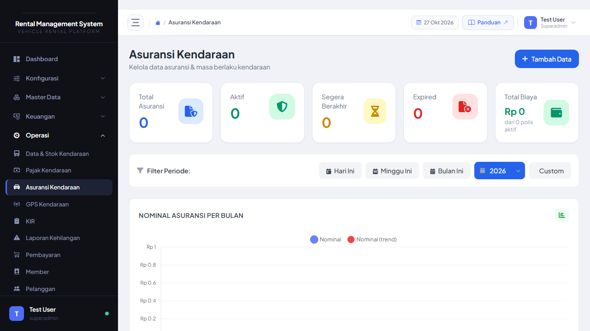

## A. LIHAT DAFTAR ASURANSI

Cara melihat status asuransi semua kendaraan:

1. **Klik menu "Compliance"** di sidebar

2. **Klik submenu "Asuransi Kendaraan"**

3. **Akan tampil tabel daftar asuransi kendaraan:**### Penjelasan Kolom:

- **Nomor Polisi** - Plat nomor kendaraan
- **Jenis Asuransi** - Tipe asuransi (All Risk, TLO, Comprehensive)
- **Perusahaan Asuransi** - Nama provider (Sinarmas, Astra, dll)
- **Nomor Polis** - Nomor polis asuransi
- **Tanggal Mulai** - Tanggal asuransi berlaku
- **Tanggal Expired** - Tanggal berakhir asuransi
- **Premi** - Biaya premi per periode
- **Status** - Badge warna (Hijau/Kuning/Merah)

---

## B. PERPANJANG ASURANSI

Cara memperpanjang asuransi kendaraan:

1. **Cari kendaraan** yang asuransinya akan expired

2. **Klik tombol "Perpanjang"**

   3. **Akan muncul form perpanjang asuransi:**4. **Isi form perpanjang asuransi:**

   **Data Wajib:**
   - **Jenis Asuransi** - Pilih: All Risk / TLO / Comprehensive
   - **Perusahaan Asuransi** - Pilih dari dropdown atau ketik nama baru
   - **Nomor Polis** - Nomor polis asuransi baru
   - **Tanggal Mulai** - Tanggal berlaku asuransi baru
   - **Tanggal Expired** - Tanggal berakhir (biasanya 1 tahun dari mulai)
   - **Premi** - Biaya premi yang dibayarkan
   - **Bukti Polis** - Upload file polis asuransi (PDF, JPG, PNG)

   **Data Opsional:**
   - **Nilai Pertanggungan** - Total coverage asuransi
   - **Keterangan** - Catatan tambahan

5. **Upload Bukti Polis:**

   a. Klik tombol "**Pilih File**"
   
   b. Pilih file polis dari komputer (PDF lebih baik)
   
   c. Nama file akan muncul setelah dipilih

6. **Klik tombol "Ajukan"**

7. **Pengajuan masuk ke PO** untuk approval Superadmin

8. **Status asuransi** berubah menjadi "**Menunggu Approval**"

---

## C. AJUKAN ULANG (Jika Ditolak)

Jika pengajuan perpanjang asuransi ditolak:

1. **Buka menu Asuransi Kendaraan**

2. **Cari kendaraan** dengan badge "Ditolak" (merah)

3. **Klik tombol "Ajukan Ulang"**

   4. **Form ajukan ulang muncul** dengan data lama masih terisi

5. **Lihat alasan penolakan** di bagian "Catatan Approval"

6. **Perbaiki data** yang salah:
   - Ganti nomor polis jika salah
   - Upload ulang file polis yang lebih jelas
   - Cek tanggal expired apakah sudah benar

7. **Klik "Ajukan"** lagi

8. **Pengajuan masuk review ulang**

**Tips:**
- Pastikan file polis jelas dan terbaca
- Cek masa berlaku asuransi (biasanya 12 bulan)
- Konfirmasi dengan pihak asuransi sebelum input

---

# BAB 5: GPS KENDARAAN

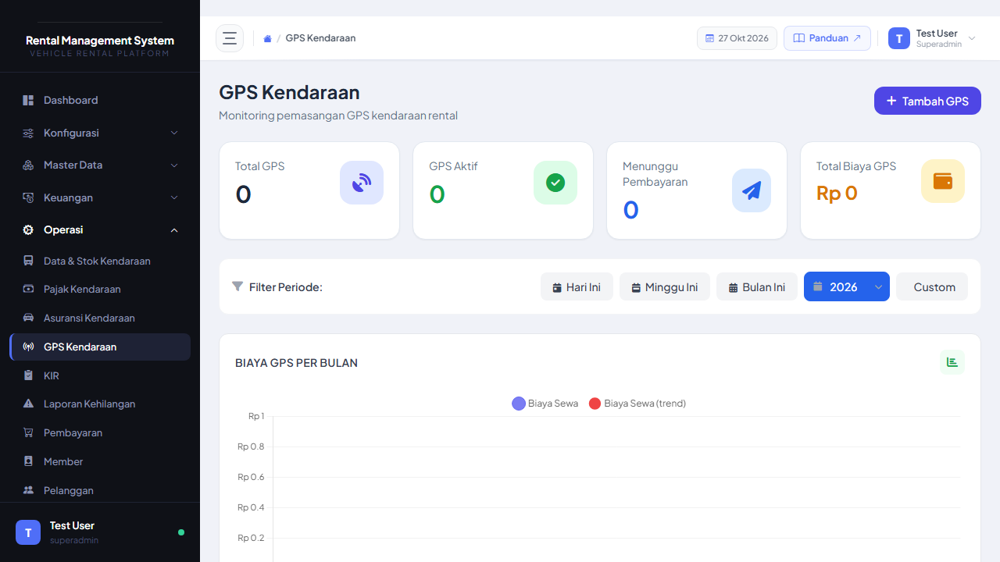

## A. LIHAT STATUS GPS

Cara melihat status GPS tracking kendaraan:

1. **Klik menu "Compliance"** di sidebar

2. **Klik submenu "GPS Kendaraan"**

3. **Akan tampil tabel GPS kendaraan:**### Penjelasan Kolom:

- **Nomor Polisi** - Plat nomor kendaraan
- **Provider GPS** - Perusahaan penyedia (Telkomsel, XL, dll)
- **Nomor IMEI** - Nomor seri GPS device
- **Nomor SIM Card** - Nomor kartu SIM di GPS
- **Tanggal Pasang** - Kapan GPS dipasang
- **Tanggal Expired** - Berakhir layanan GPS
- **Biaya Bulanan** - Biaya langganan per bulan
- **Status** - Badge warna (Hijau/Kuning/Merah)

---

## B. PERPANJANG GPS

Cara memperpanjang langganan GPS kendaraan:

1. **Cari kendaraan** yang GPS-nya akan expired

2. **Klik tombol "Perpanjang"**

   3. **Akan muncul form perpanjang GPS:**4. **Isi form perpanjang GPS:**

   **Data Wajib:**
   - **Provider GPS** - Pilih provider atau ketik nama baru
   - **Nomor IMEI** - Nomor seri GPS (biasanya sama dengan yang lama)
   - **Nomor SIM Card** - Nomor SIM di GPS (biasanya tetap)
   - **Tanggal Mulai** - Tanggal perpanjangan berlaku
   - **Tanggal Expired** - Tanggal berakhir langganan (biasanya 12 bulan dari mulai)
   - **Biaya Bulanan** - Biaya langganan per bulan
   - **Durasi** - Berapa bulan perpanjang (1, 3, 6, 12 bulan)
   - **Total Biaya** - Biaya Bulanan × Durasi (akan auto-calculate)
   - **Bukti Bayar** - Upload bukti transfer langganan GPS

   **Data Opsional:**
   - **Keterangan** - Catatan tambahan
   - **Teknisi** - Nama teknisi yang install/cek GPS

5. **Upload Bukti Bayar:**

   a. Klik "**Pilih File**"
   
   b. Pilih file bukti transfer
   
   c. Nama file muncul

6. **Klik tombol "Ajukan"**

7. **Pengajuan masuk PO** untuk approval

8. **Status GPS** berubah "**Menunggu Approval**"

---

## C. AJUKAN ULANG (Jika Ditolak)

Jika pengajuan perpanjang GPS ditolak:

1. **Buka menu GPS Kendaraan**

2. **Cari kendaraan** dengan status "Ditolak"

3. **Klik tombol "Ajukan Ulang"**

   4. **Form ajukan ulang muncul**

5. **Lihat catatan penolakan**

6. **Perbaiki data** yang salah:
   - Cek nomor IMEI dan SIM apakah benar
   - Pastikan durasi dan total biaya sesuai
   - Upload ulang bukti bayar yang lebih jelas

7. **Klik "Ajukan"**

8. **Pengajuan masuk review ulang**

**Catatan:**
- GPS harus dalam kondisi ON dan terpasang baik
- Cek signal GPS sebelum perpanjang
- Koordinasi dengan teknisi jika ada masalah hardware

---

# BAB 6: KIR

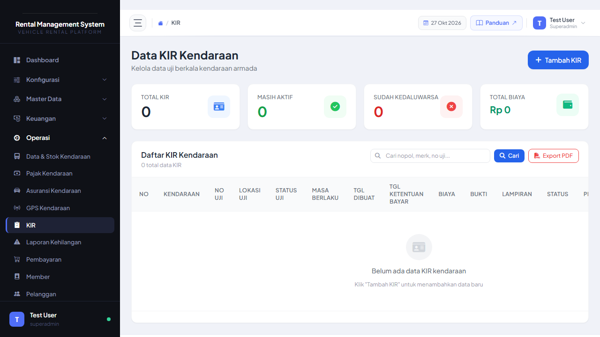

## A. LIHAT STATUS KIR

Cara melihat status KIR (Kendaraan Inspeksi Ringan) kendaraan:

1. **Klik menu "Compliance"** di sidebar

2. **Klik submenu "KIR"**

3. **Akan tampil tabel KIR kendaraan:**### Penjelasan Kolom:

- **Nomor Polisi** - Plat nomor kendaraan
- **Nomor KIR** - Nomor surat KIR
- **Tanggal Uji** - Kapan kendaraan uji KIR terakhir
- **Tanggal Expired** - Berakhir masa berlaku KIR
- **Status Uji** - Status hasil uji (Lulus / Tidak Lulus / Belum Uji)
- **Tempat Uji** - Lokasi uji KIR
- **Status** - Badge warna

**Catatan:** KIR wajib untuk kendaraan umum/operasional/rental

---

## B. PERPANJANG KIR

Cara memperpanjang KIR kendaraan yang akan expired:

1. **Cari kendaraan** yang KIR-nya akan expired

2. **Klik tombol "Perpanjang"**

   3. **Akan muncul form perpanjang KIR:**4. **Isi form perpanjang KIR:**

   **Data Wajib:**
   - **Nomor KIR** - Nomor surat KIR (biasanya sama, kecuali ada perubahan)
   - **Tanggal Uji** - Tanggal kendaraan diuji KIR
   - **Tanggal Expired** - Berakhir KIR baru (6 bulan atau 12 bulan tergantung jenis kendaraan)
   - **Tempat Uji** - Lokasi uji KIR (Dinas Perhubungan, dll)
   - **Biaya Uji** - Biaya yang dibayarkan untuk uji KIR
   - **Bukti KIR** - Upload file surat KIR atau bukti lulus uji (PDF, JPG, PNG)

   **Data Opsional:**
   - **Petugas Uji** - Nama petugas yang handle
   - **Keterangan** - Catatan hasil uji atau kondisi kendaraan

5. **Upload Bukti KIR:**

   a. Klik "**Pilih File**"
   
   b. Pilih file surat KIR atau bukti lulus uji
   
   c. Nama file muncul

6. **Klik tombol "Ajukan"**

7. **Pengajuan masuk PO** untuk approval

8. **Status KIR** berubah "**Menunggu Approval**"

---

## C. UPDATE STATUS UJI

Cara update status hasil uji KIR:

1. **Buka menu KIR**

2. **Cari kendaraan** yang sudah diuji tapi statusnya masih "Belum Uji"

3. **Klik tombol "Update Status"**

   4. **Akan muncul form update status:**5. **Pilih Status Uji:**
   - **Lulus** - Jika kendaraan lulus uji KIR
   - **Tidak Lulus** - Jika kendaraan tidak lulus (harus perbaikan dulu)
   - **Belum Uji** - Jika belum sempat uji

6. **Isi Keterangan** (opsional):
   - Jika Lulus: "Kendaraan dalam kondisi baik, lulus semua tes"
   - Jika Tidak Lulus: "Tidak lulus karena rem kurang pakem, perlu perbaikan"

7. **Klik "Update"**

8. **Status akan berubah** sesuai pilihan

**Catatan:**
- Jika Tidak Lulus, kendaraan harus diperbaiki dulu sebelum uji ulang
- Koordinasi dengan bengkel untuk perbaikan yang diperlukan
- Setelah perbaikan selesai, uji ulang dan update status jadi "Lulus"

---

## D. AJUKAN ULANG (Jika Ditolak)

Jika pengajuan perpanjang KIR ditolak:

1. **Buka menu KIR**

2. **Cari kendaraan** dengan status "Ditolak"

3. **Klik tombol "Ajukan Ulang"**

4. **Form ajukan ulang muncul**

5. **Lihat catatan penolakan**

6. **Perbaiki data:**
   - Upload ulang bukti KIR yang lebih jelas
   - Cek tanggal expired apakah sudah benar
   - Pastikan nomor KIR sesuai dengan dokumen

7. **Klik "Ajukan"**

8. **Pengajuan masuk review ulang**

---

# BAB 7: LAPORAN KEHILANGAN

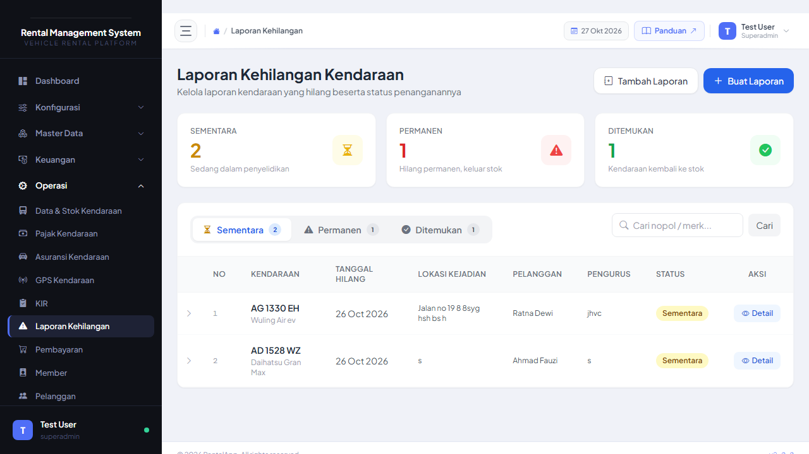

## A. BUAT LAPORAN KEHILANGAN

Cara membuat laporan jika ada kendaraan yang hilang:

1. **Klik menu "Laporan Kehilangan"** di sidebar

   2. **Klik tombol "Buat Laporan Baru"**

   3. **Akan muncul form laporan kehilangan:**

   4. **Isi form laporan kehilangan:**

   **Data Wajib:**
   - **Kendaraan** - Pilih kendaraan yang hilang dari dropdown
   - **Tanggal Kejadian** - Kapan kendaraan hilang (format: dd/mm/yyyy)
   - **Lokasi Kejadian** - Di mana kendaraan hilang terakhir terlihat
   - **Kronologi** - Ceritakan kejadian secara detail
   - **Status** - Pilih: Hilang / Dicuri / Dirampok

   **Data Opsional:**
   - **Pelapor** - Nama orang yang melapor
   - **Saksi** - Nama saksi (jika ada)
   - **Nomor Polisi Laporan** - Nomor LP dari kepolisian (jika sudah lapor)
   - **Foto Bukti** - Upload foto lokasi/barang bukti (JPG, PNG)

5. **Upload Foto Bukti (Opsional):**

   a. Klik tombol "**Pilih File**"
   
   b. Pilih foto dari komputer
   
   c. Foto akan preview setelah dipilih

6. **Klik tombol "Simpan Laporan"**

7. **Laporan akan tersimpan** dengan status "Dalam Investigasi"

   **Catatan:**
- Segera buat laporan setelah tahu kendaraan hilang
- Lapor ke polisi dan input nomor LP-nya
- Upload foto bukti sebanyak mungkin
- Koordinasi dengan asuransi untuk klaim

---

## B. LIHAT STATUS LAPORAN

Cara melihat status laporan kehilangan:

1. **Buka menu "Laporan Kehilangan"**

2. **Akan tampil tabel semua laporan:**

   ### Penjelasan Status:

- **Merah (Dalam Investigasi)** - Laporan baru, sedang diselidiki
- **Kuning (Ditemukan)** - Kendaraan sudah ditemukan, proses verifikasi
- **Hijau (Selesai)** - Kasus sudah selesai (kendaraan kembali atau klaim asuransi selesai)
- **Abu-abu (Ditutup)** - Kasus ditutup tanpa penyelesaian

---

## C. TAMBAH LAPORAN FOLLOW-UP

Cara menambah update/perkembangan pada laporan yang sudah ada:

1. **Cari laporan** yang ingin di-update

2. **Klik tombol "Detail"** pada kolom Aksi

   3. **Akan muncul halaman detail laporan**

   4. **Klik tombol "Tambah Laporan Follow-up"**

   5. **Isi form follow-up:**

   - **Tanggal** - Tanggal update (format: dd/mm/yyyy)
   - **Keterangan** - Update perkembangan kasus
   - **Foto Bukti** - Upload foto tambahan (opsional)

   Contoh keterangan:
   - "Sudah lapor polisi, nomor LP: 123/ABC/2026"
   - "Kendaraan ditemukan di lokasi XYZ"
   - "Klaim asuransi sudah diproses"

6. **Klik "Simpan"**

7. **Follow-up akan muncul** di timeline laporan

**Catatan:**
- Update laporan secara berkala
- Lampirkan foto/dokumen pendukung
- Catat semua komunikasi dengan polisi dan asuransi

---

# BAB 8: PEMBAYARAN

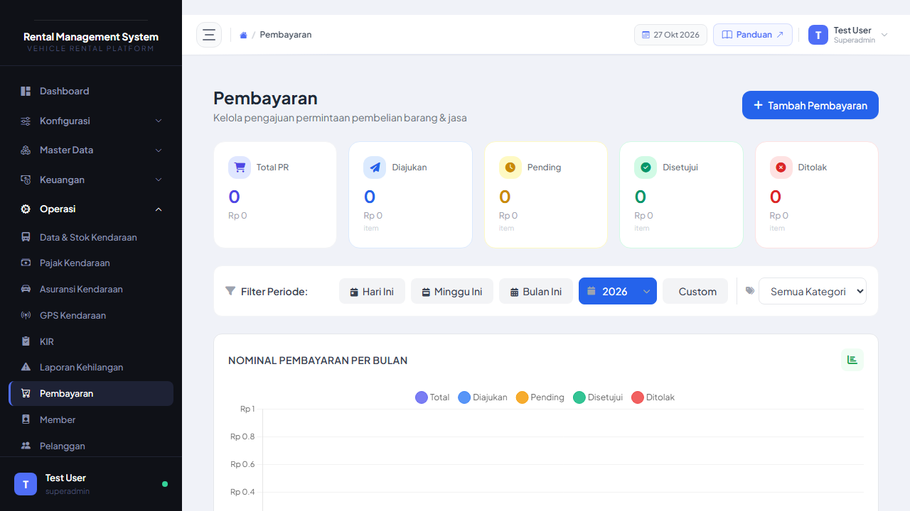

## A. LIHAT DAFTAR PEMBAYARAN

Cara melihat semua pembayaran (pengeluaran kendaraan):

1. **Klik menu "Procurement"** di sidebar

2. **Klik submenu "Pembayaran"**

3. **Akan tampil tabel daftar pembayaran:**

   ### Penjelasan Kolom:

- **Nomor PO** - Nomor Purchase Order
- **Sumber** - Dari mana pembayaran (Service Part, GPS, Pajak, dll)
- **Kendaraan** - Nomor polisi kendaraan (jika ada)
- **Total Biaya** - Jumlah yang harus dibayar
- **Status** - Badge approval (Diajukan/Disetujui/Ditolak)
- **Tanggal** - Kapan pembayaran diajukan

### Penjelasan Status Badge:

- **Kuning (Diajukan)** - Menunggu approval Superadmin
- **Hijau (Disetujui)** - Sudah diapprove, siap dibayar
- **Merah (Ditolak)** - Ditolak, perlu ajukan ulang
- **Biru (Disetujui Sebagian)** - Sebagian item disetujui

---

## B. BUAT PEMBAYARAN BARU

Cara membuat pembayaran untuk pengeluaran kendaraan:

1. **Klik tombol "Buat Pembayaran"** di pojok kanan atas

   2. **Akan muncul form pembayaran:**

   3. **Isi form pembayaran:**

   **Data Wajib:**
   - **Sumber** - Pilih: Service Part / Service Asuransi / Service Incident / GPS / Pajak / KIR / Asuransi / STNK / Lainnya
   - **Kendaraan** - Pilih kendaraan (jika terkait kendaraan)
   - **Pemohon** - Nama orang yang mengajukan
   - **Departemen** - Pilih departemen pemohon
   - **Keterangan** - Penjelasan pembayaran
   - **Items** - Detail pengeluaran (nama item, jumlah, harga)

4. **Tambah Item Pengeluaran:**

   a. Klik tombol "**+ Tambah Item**"
   
   b. Isi:
      - **Nama Item** - Contoh: "Oli Mesin", "Premi Asuransi"
      - **Jumlah** - Contoh: 4 (untuk oli 4 liter)
      - **Harga Satuan** - Contoh: 50000
      - **Total** - Auto-calculate (Jumlah × Harga)
   
   c. Klik "**Simpan Item**"
   
   d. Ulangi untuk item lainnya

5. **Upload Bukti Bayar:**

   a. Klik "**Pilih File**"
   
   b. Pilih file bukti transfer/invoice
   
   c. File akan preview

6. **Klik tombol "Ajukan"**

7. **Pembayaran masuk ke approval Superadmin**

   **Tips:**
- Pastikan semua bukti lengkap sebelum ajukan
- Isi keterangan sejelas mungkin
- Upload invoice asli dari vendor

---

## C. APPROVAL PEMBAYARAN (Superadmin Only)

Cara approve atau reject pembayaran (hanya Superadmin):

1. **Buka menu Pembayaran**

2. **Cari pembayaran** dengan status "Diajukan" (badge kuning)

3. **Klik tombol "Review"**

   4. **Akan muncul modal approval:**

   5. **Review setiap item:**

   - Cek apakah item wajar
   - Cek harga apakah sesuai market
   - Cek bukti bayar apakah valid

6. **Pilih action:**

   **Opsi A: Setujui Semua**
   - Centang semua item
   - Klik tombol "**Setujui**" (hijau)

   **Opsi B: Setujui Sebagian**
   - Centang hanya item yang disetujui
   - Klik tombol "**Setujui Item Terpilih**"
   - Item yang tidak dicentang akan masuk PO baru (ditolak)

   **Opsi C: Tolak Semua**
   - Klik tombol "**Tolak**" (merah)
   - Isi alasan penolakan
   - Klik "**Konfirmasi Tolak**"

7. **Status pembayaran berubah** sesuai action

**Catatan Superadmin:**
- Cek dengan teliti sebelum approve
- Jika ragu, tanya pemohon dulu
- Gunakan fitur "Setujui Sebagian" jika ada item yang mencurigakan

---

# BAB 9: MEMBER

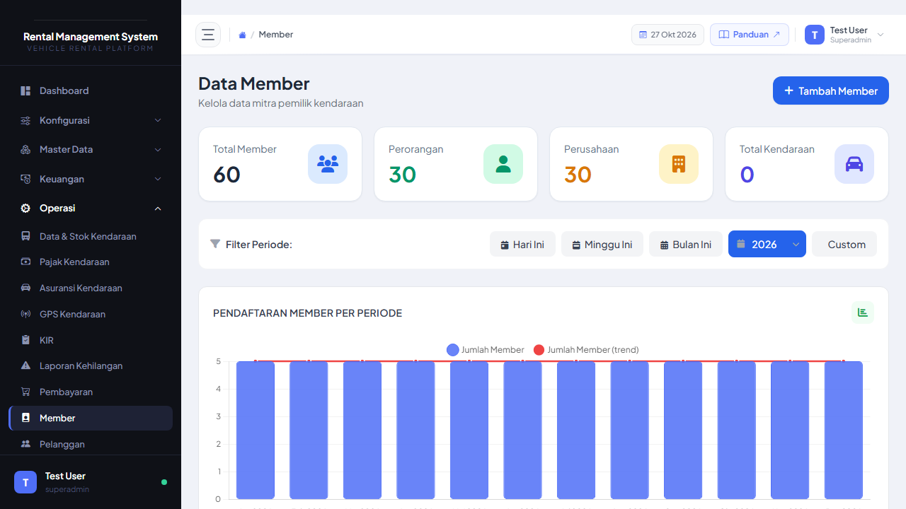

## A. LIHAT DATA MEMBER

Cara melihat daftar member (penyewa kendaraan dengan membership):

1. **Klik menu "Rental"** di sidebar

2. **Klik submenu "Member"**

3. **Akan tampil tabel daftar member:**

   ### Penjelasan Kolom:

- **Nama** - Nama lengkap member
- **NIK** - Nomor Induk Kependudukan
- **Email** - Email member
- **Telepon** - Nomor HP member
- **Status** - Aktif / Nonaktif
- **Aksi** - Tombol Edit dan Hapus

---

## B. TAMBAH MEMBER BARU

Cara menambahkan member baru:

1. **Klik tombol "Tambah Member"**

   2. **Akan muncul form tambah member:**

   3. **Isi form member:**

   **Data Wajib:**
   - **Nama Lengkap** - Sesuai KTP
   - **NIK** - 16 digit NIK
   - **Email** - Email aktif member
   - **Telepon** - Nomor HP aktif
   - **Alamat** - Alamat lengkap sesuai KTP
   - **Status** - Pilih: Aktif / Nonaktif

   **Data Opsional:**
   - **Tanggal Lahir** - Format: dd/mm/yyyy
   - **Jenis Kelamin** - Laki-laki / Perempuan
   - **Pekerjaan** - Profesi member
   - **Perusahaan** - Tempat bekerja (jika ada)

4. **Upload Dokumen Member:**

   a. **Foto KTP** - Scan/foto KTP member
      - Klik "**Pilih File**" di bagian Foto KTP
      - Pilih file KTP (JPG, PNG)
   
   b. **Foto SIM** - Scan/foto SIM (opsional)
      - Klik "**Pilih File**" di bagian Foto SIM
      - Pilih file SIM (JPG, PNG)
   
   c. **STNK** - Upload STNK jika member punya kendaraan sendiri (opsional)

5. **Klik tombol "Simpan"**

6. **Member baru tersimpan** dan bisa langsung rental kendaraan

   **Catatan:**
- Pastikan NIK dan nomor telepon valid
- Foto KTP wajib untuk verifikasi identitas
- Status Aktif agar member bisa rental

---

## C. EDIT/HAPUS MEMBER

### Edit Member:

1. **Cari member** yang ingin diedit

2. **Klik icon "Edit" (pensil)**

   3. **Form edit muncul** dengan data terisi

4. **Ubah data** yang perlu diubah

5. **Klik "Update"**

### Hapus Member:

1. **Cari member** yang ingin dihapus

2. **Klik icon "Hapus" (tempat sampah)**

   3. **Konfirmasi hapus muncul**

4. **Klik "Ya, Hapus!"**

**Catatan:**
- Member yang punya rental aktif tidak bisa dihapus
- Ubah status jadi "Nonaktif" jika member tidak aktif lagi

---

# BAB 10: PELANGGAN

## A. LIHAT DATA PELANGGAN

Cara melihat daftar pelanggan (penyewa non-member):

1. **Klik menu "Master Data"** di sidebar

2. **Klik submenu "Pelanggan"**

3. **Akan tampil tabel pelanggan:**

   **Perbedaan Member vs Pelanggan:**
- **Member** - Penyewa yang punya membership, dapat benefit khusus
- **Pelanggan** - Penyewa biasa, rental langsung tanpa membership

---

## B. TAMBAH PELANGGAN BARU

Cara menambahkan pelanggan baru:

1. **Klik tombol "Tambah Pelanggan"**

   2. **Akan muncul form tambah pelanggan:**

   3. **Isi form pelanggan:**

   **Data Wajib:**
   - **Nama Lengkap** - Sesuai KTP
   - **NIK** - 16 digit
   - **Telepon** - Nomor HP
   - **Alamat** - Alamat lengkap

   **Data Opsional:**
   - **Email** - Email pelanggan (jika ada)
   - **Perusahaan** - Nama perusahaan (untuk pelanggan corporate)
   - **Keterangan** - Catatan tambahan

4. **Klik tombol "Simpan"**

5. **Pelanggan tersimpan** dan bisa langsung rental

**Catatan:**
- Form pelanggan lebih simple dari member
- Tidak perlu upload dokumen
- Cocok untuk rental sekali jalan (walk-in customer)

---

## C. EDIT/HAPUS PELANGGAN

### Edit Pelanggan:

1. **Cari pelanggan** di tabel

2. **Klik icon "Edit"**

3. **Ubah data** yang perlu diubah

4. **Klik "Update"**

### Hapus Pelanggan:

1. **Klik icon "Hapus"**

2. **Konfirmasi hapus**

3. **Klik "Ya, Hapus!"**

**Catatan:**
- Pelanggan dengan rental aktif tidak bisa dihapus
- Data pelanggan bisa di-archive jika sudah lama tidak rental

---

# BAB 11: BOOKING KENDARAAN

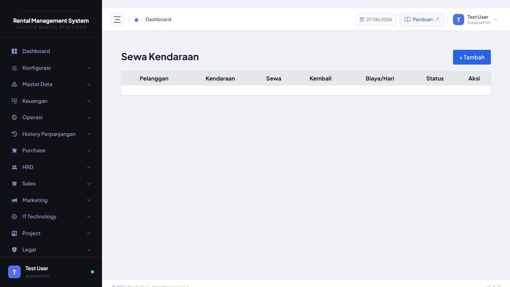

## A. BUAT BOOKING BARU

Cara membuat booking/reservasi kendaraan:

1. **Klik menu "Rental"** di sidebar

2. **Klik submenu "Booking Kendaraan"**

3. **Klik tombol "Buat Booking"**

   4. **Akan muncul form booking:**

   5. **Isi form booking:**

   **Data Wajib:**
   - **Pelanggan/Member** - Pilih dari dropdown atau buat baru
   - **Kendaraan** - Pilih kendaraan yang tersedia
   - **Tanggal Mulai** - Kapan rental dimulai (dd/mm/yyyy)
   - **Tanggal Selesai** - Kapan rental berakhir (dd/mm/yyyy)
   - **Durasi** - Auto-calculate (hari)
   - **Harga per Hari** - Harga rental per hari
   - **Total Harga** - Auto-calculate (Durasi × Harga/Hari)

   **Data Opsional:**
   - **Supir** - Apakah pakai supir? (Ya/Tidak)
   - **Biaya Supir** - Jika pakai supir, berapa biayanya
   - **DP (Down Payment)** - Uang muka (opsional)
   - **Keterangan** - Catatan booking

6. **Klik tombol "Simpan Booking"**

7. **Booking tersimpan** dengan status "Pending"

   **Catatan:**
- Cek ketersediaan kendaraan sebelum booking
- DP minimal 20% dari total harga (opsional)
- Konfirmasi ke pelanggan via telepon/WA

---

## B. LIHAT STATUS BOOKING

Cara melihat semua booking yang ada:

1. **Buka menu "Booking Kendaraan"**

2. **Akan tampil tabel booking:**

   ### Penjelasan Status:

- **Kuning (Pending)** - Booking baru, menunggu konfirmasi
- **Biru (Confirmed)** - Booking sudah dikonfirmasi, siap rental
- **Hijau (Selesai)** - Rental sudah selesai
- **Merah (Dibatalkan)** - Booking dibatalkan

---

## C. UPDATE STATUS BOOKING

Cara mengubah status booking:

1. **Cari booking** yang ingin diupdate

2. **Klik tombol "Update Status"**

   3. **Akan muncul dropdown pilihan status:**

   4. **Pilih status baru:**
   - **Confirmed** - Jika pelanggan sudah bayar DP dan booking fix
   - **Dibatalkan** - Jika pelanggan cancel booking

5. **Klik "Update"**

6. **Status berubah** dan kendaraan availability ter-update

**Catatan:**
- Update status segera setelah dapat konfirmasi pelanggan
- Jika status jadi "Confirmed", kendaraan akan reserved untuk tanggal tersebut
- Jika "Dibatalkan", kendaraan jadi available lagi

---

# BAB 12: KENDARAAN AKTIF & HISTORY

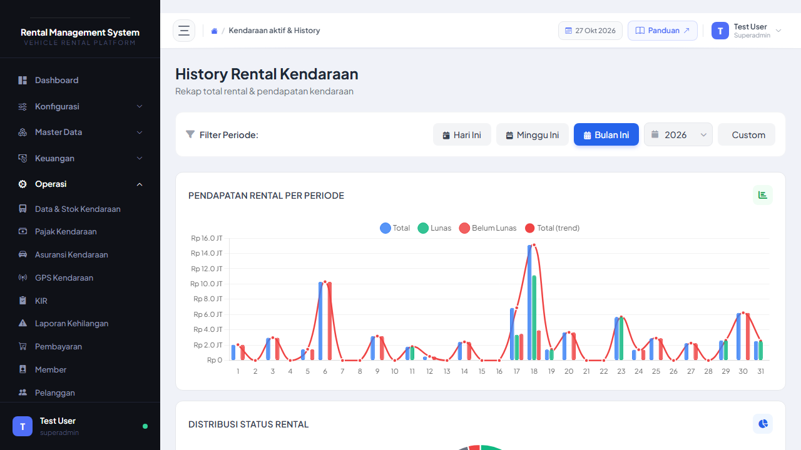

## A. LIHAT KENDARAAN AKTIF

Cara melihat kendaraan yang sedang dirental:

1. **Klik menu "Rental"** di sidebar

2. **Klik submenu "Rental Aktif"**

3. **Akan tampil tabel rental yang sedang berjalan:**

   ### Penjelasan Kolom:

- **Nomor Polisi** - Plat kendaraan
- **Pelanggan** - Nama penyewa
- **Tanggal Mulai** - Kapan rental dimulai
- **Tanggal Selesai** - Kapan rental berakhir
- **Sisa Hari** - Berapa hari lagi rental selesai
- **Total Biaya** - Biaya rental keseluruhan
- **Status Bayar** - Lunas / Belum Lunas / DP
- **Status Rental** - Aktif / Selesai / Overdue

### Penjelasan Status Rental:

- **Hijau (Aktif)** - Rental berjalan normal
- **Kuning (Akan Selesai)** - Rental akan selesai dalam 3 hari
- **Merah (Overdue)** - Rental sudah lewat tanggal selesai, belum dikembalikan

---

## B. LIHAT HISTORY RENTAL

Cara melihat history semua rental yang sudah selesai:

1. **Buka menu "Rental"**

2. **Klik submenu "History Rental"**

3. **Akan tampil tabel history:**

   ### Filter History:

Anda bisa filter history berdasarkan:
- **Periode** - Pilih rentang tanggal
- **Kendaraan** - Filter per kendaraan tertentu
- **Pelanggan** - Filter per pelanggan
- **Status Bayar** - Lunas / Belum Lunas

---

## C. EXPORT LAPORAN

Cara export data rental ke PDF atau Excel:

1. **Buka "Rental Aktif" atau "History Rental"**

2. **Atur filter** sesuai kebutuhan (periode, kendaraan, dll)

3. **Klik tombol "Export"** di pojok kanan atas

   4. **Pilih format export:**
   - **PDF** - Untuk laporan cetak
   - **Excel** - Untuk analisis data

5. **File akan otomatis ter-download**

6. **Buka file** hasil export

**Kegunaan Export:**
- Laporan bulanan untuk manajemen
- Analisis pendapatan rental
- Arsip data untuk audit
- Share ke stakeholder

---

# BAB 13: SERVICE KENDARAAN

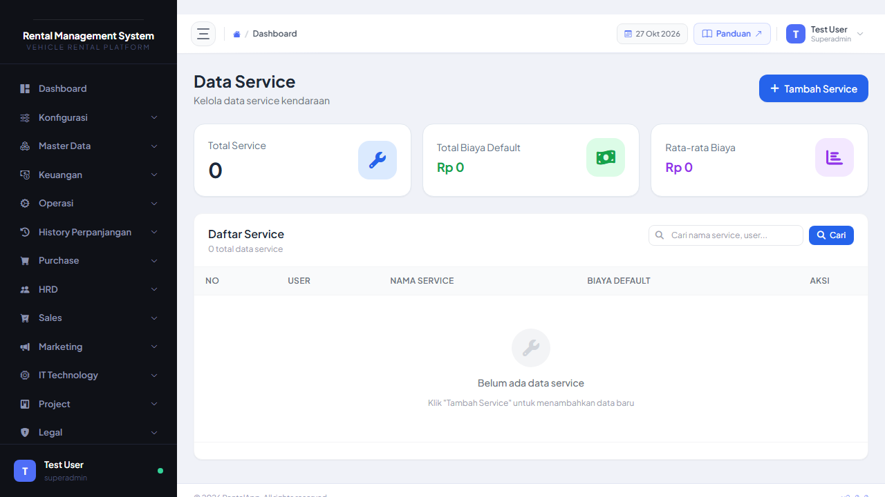

## A. SERVICE RUTIN

Cara input service rutin kendaraan:

1. **Klik menu "Service"** di sidebar

2. **Klik submenu "Service History"**

3. **Klik tombol "Tambah Service"**

   4. **Akan muncul form service:**

   5. **Isi form service:**

   **Data Wajib:**
   - **Kendaraan** - Pilih kendaraan yang di-service
   - **Tanggal Service** - Kapan service dilakukan
   - **Kilometer** - Kilometer saat service
   - **Kategori Service** - Pilih: Ganti Oli / Tune Up / Service Berkala / Lainnya
   - **Bengkel/Supplier** - Pilih bengkel atau supplier parts

6. **Tambah Part yang Diganti:**

   a. Klik "**+ Tambah Part**"
   
   b. Isi:
      - **Nama Part** - Contoh: "Filter Oli", "Kampas Rem"
      - **Jumlah** - Berapa unit
      - **Harga Satuan** - Harga per unit
      - **Total** - Auto-calculate
      - **Garansi** - Berapa bulan garansi (opsional)
      - **Garansi KM** - Berapa KM garansi (opsional)
   
   c. Klik "**Simpan Part**"

7. **Upload Bukti Service:**

   - Upload invoice dari bengkel
   - Upload foto kondisi kendaraan (before/after)

8. **Klik tombol "Simpan"**

9. **Service akan masuk ke Purchase Order** untuk approval Superadmin

**Catatan:**
- Service rutin wajib setiap 5.000 KM atau 6 bulan
- Pastikan semua part tercatat dengan detail
- Simpan invoice asli dari bengkel

---

## B. SERVICE ASURANSI (Klaim)

Cara input service klaim asuransi:

1. **Klik menu "Service"**

2. **Klik submenu "Service Asuransi"**

3. **Klik "Tambah Service Asuransi"**

   4. **Isi form service asuransi:**

   **Data Wajib:**
   - **Kendaraan** - Pilih kendaraan yang klaim
   - **Tanggal Kejadian** - Kapan insiden terjadi
   - **Jenis Klaim** - All Risk / TLO / Comprehensive
   - **Nomor Klaim** - Nomor klaim dari perusahaan asuransi
   - **Perusahaan Asuransi** - Pilih provider asuransi

5. **Tambah Kejadian yang Diklaim:**

   a. Klik "**+ Tambah Kejadian**"
   
   b. Isi:
      - **Nama Kejadian** - Contoh: "Kaca Depan Pecah", "Body Penyok"
      - **Biaya Estimasi** - Estimasi biaya repair
      - **Keterangan** - Detail kerusakan
   
   c. Klik "**Simpan Kejadian**"

6. **Upload Dokumen Klaim:**

   - Surat klaim dari asuransi
   - Foto kerusakan
   - Laporan polisi (jika ada)

7. **Klik "Ajukan"**

8. **Klaim masuk PO** untuk approval

**Catatan:**
- Lakukan klaim maksimal 3×24 jam setelah kejadian
- Upload foto kerusakan dari berbagai sudut
- Koordinasi dengan surveyor asuransi

---

## C. SERVICE INCIDENT (Kecelakaan)

Cara input service untuk kecelakaan yang tidak di-cover asuransi:

1. **Klik menu "Service"**

2. **Klik submenu "Service Incident"**

3. **Klik "Tambah Service Incident"**

   4. **Isi form service incident:**

   **Data Wajib:**
   - **Kendaraan** - Pilih kendaraan
   - **Tanggal Kejadian** - Kapan kecelakaan terjadi
   - **Lokasi Kejadian** - Di mana kecelakaan terjadi
   - **Kronologi** - Cerita kejadian secara detail
   - **Pihak Terlibat** - Siapa saja yang terlibat (driver, pihak ketiga, dll)

5. **Tambah Part yang Rusak:**

   a. Klik "**+ Tambah Part**"
   
   b. Isi:
      - **Nama Part** - Contoh: "Bemper Depan", "Lampu Sein Kiri"
      - **Kategori Service** - Pilih kategori kerusakan
      - **Jumlah** - Berapa unit
      - **Harga Satuan** - Harga repair/ganti
      - **Supplier** - Bengkel yang handle
      - **Total** - Auto-calculate
   
   c. Klik "**Simpan Part**"

6. **Upload Bukti:**

   - Foto kerusakan kendaraan
   - Laporan polisi (jika ada)
   - Invoice bengkel

7. **Klik "Ajukan"**

8. **Incident masuk PO** untuk approval

**Catatan:**
- Service incident untuk kerusakan di luar asuransi
- Biasanya biaya dibebankan ke penyewa (jika ada)
- Koordinasi dengan pihak terkait (polisi, penyewa, bengkel)

---

# BAB 14: DATA LEASING

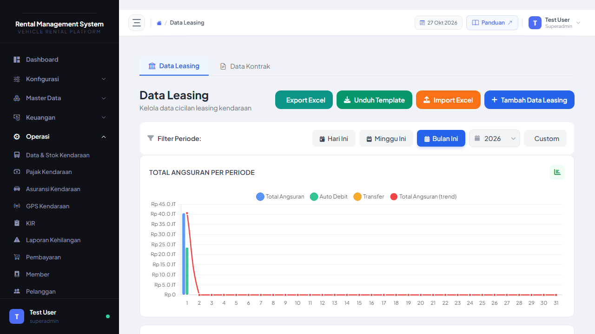

## A. LIHAT DATA LEASING

Cara melihat data kendaraan yang dibeli secara leasing:

1. **Klik menu "Invoicing"** di sidebar

2. **Klik submenu "Data Leasing"**

3. **Akan tampil tabel data leasing:**

   ### Penjelasan Kolom:

- **Nomor Polisi** - Plat kendaraan
- **Perusahaan Leasing** - Provider leasing (BCA Finance, Adira, dll)
- **Nomor Kontrak** - Nomor kontrak leasing
- **Harga Kendaraan** - OTR saat beli
- **DP** - Down Payment yang sudah dibayar
- **Cicilan per Bulan** - Angsuran bulanan
- **Tenor** - Jangka waktu cicilan (bulan)
- **Sisa Tenor** - Berapa bulan lagi lunas
- **Status** - Aktif / Lunas / Menunggak

---

## B. TAMBAH DATA LEASING BARU

Cara menambahkan data leasing untuk kendaraan baru:

1. **Klik tombol "Tambah Leasing"**

   2. **Akan muncul form leasing:**

   3. **Isi form leasing:**

   **Data Wajib:**
   - **Kendaraan** - Pilih kendaraan yang dibeli leasing
   - **Perusahaan Leasing** - Nama provider leasing
   - **Nomor Kontrak** - Nomor kontrak leasing
   - **Tanggal Kontrak** - Kapan kontrak dimulai
   - **Harga Kendaraan (OTR)** - On The Road price
   - **Down Payment (DP)** - Uang muka yang dibayar
   - **Cicilan per Bulan** - Angsuran bulanan
   - **Tenor** - Jangka waktu (bulan)
   - **Bunga per Tahun** - Suku bunga leasing (%)

4. **Upload Dokumen Leasing:**

   - Kontrak leasing (PDF)
   - BPKB asli/salinan
   - Faktur pembelian

5. **Klik tombol "Simpan"**

6. **Data leasing tersimpan** dan sistem akan auto-calculate sisa tenor

**Catatan:**
- Data leasing penting untuk tracking aset
- Pastikan tanggal jatuh tempo cicilan tercatat
- Set reminder untuk pembayaran cicilan

---

## C. EDIT/HAPUS DATA LEASING

### Edit Data Leasing:

1. **Cari kendaraan** di tabel leasing

2. **Klik icon "Edit"**

   3. **Ubah data** yang perlu diupdate

   Contoh update:
   - Bayar cicilan → Update "Sisa Tenor"
   - Pelunasan → Ubah "Status" jadi "Lunas"

4. **Klik "Update"**

### Hapus Data Leasing:

1. **Klik icon "Hapus"**

2. **Konfirmasi hapus**

3. **Klik "Ya, Hapus!"**

**Catatan:**
- Hanya hapus jika input data salah
- Jika kendaraan sudah lunas, ubah status jadi "Lunas" (jangan dihapus)
- Data leasing penting untuk laporan keuangan

---

**© 2026 PT Rental Kendaraan Indonesia. All rights reserved.**

---

## KONTAK SUPPORT

Jika mengalami kendala teknis:

- **Email:** support@apyrent.com
- **Phone:** +62-xxx-xxxx-xxxx
- **WhatsApp:** +62-xxx-xxxx-xxxx
- **Jam Operasional:** Senin - Jumat, 08:00 - 17:00 WIB
